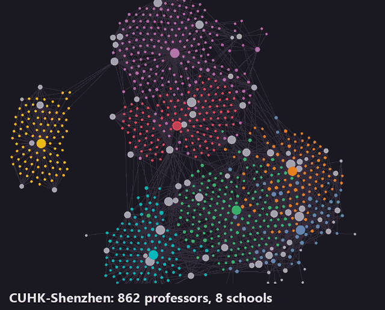

# CUHK-Shenzhen faculty scraper

Browse every professor at CUHK-Shenzhen in one place, and see who appears to be taking research assistants.

The tool scrapes the faculty directory of every school, merges people listed by more than one school, crawls each professor's personal site, looks for recruiting statements, and writes everything to a linked [Obsidian](https://obsidian.md) vault. It can also rank professors by how well their work matches topics you choose.

<!-- Screenshot of Obsidian's graph view: save it as docs/graph-view.png -->


*The vault in Obsidian's graph view. Each school has its own colour, and grey nodes are shared research-interest pages that link professors across schools.*

```text
$ cuhksz-faculty run
sai: list page 0: 10 new
sds: list page 0: 10 new
...
Wrote 862 notes to vault. 62 show evidence of taking RAs, interns or undergraduates.
```

The [`vault`](vault) folder in this repository is a ready-made copy, scraped in November 2026. Open it in Obsidian with **Open folder as vault** and start at `00 Start here`. It has one note per professor with their rank, schools, contact details, research interests, education, biography, profile publications and hiring evidence. It has no compatibility scores.

## Install

Requires Python 3.11 or newer.

```bash
git clone https://github.com/rrr090/cuhksz-faculty-scraper.git
cd cuhksz-faculty-scraper
pip install .
```

## Usage

```bash
cuhksz-faculty run                    # every school
cuhksz-faculty run --school sai sds   # only some schools
cuhksz-faculty schools                # list the school keys
```

Then open the `vault` folder in Obsidian with **Open folder as vault** and start at `00 Start here`.



In the graph view, each school's professors and its school page share a colour, listed on `00 Start here`. Set `color = "#RRGGBB"` on a school in the config to change it. A rebuild replaces only these school colour groups in `.obsidian/graph.json`, so your other graph settings are kept.

Close Obsidian before rebuilding, or run **Reload app without saving** from the command palette right after. Otherwise Obsidian writes its old graph settings back over the new colours the next time you touch the graph.

The three steps can also be run separately:

| Command | What it does | Output |
|---|---|---|
| `cuhksz-faculty faculty` | Scrapes directory listings and profile pages, and merges duplicates | `data/faculty.json` |
| `cuhksz-faculty sites` | Crawls personal and lab websites | `data/sites.json` |
| `cuhksz-faculty build` | Scores, classifies and writes the vault | `vault/` |

Options: `--school KEY ...`, `--data DIR`, `--vault DIR`, `--config FILE`, `--review FILE`.

Pages are cached in `data/cache`, so rebuilding does not contact the sites again. Delete that folder to fetch fresh copies. Each note's **Outreach** and **My notes** sections are kept when you rebuild.

## Schools

| Key | School |
|---|---|
| `sai` | School of Artificial Intelligence |
| `sds` | School of Data Science |
| `sse` | School of Science and Engineering |
| `sme` | School of Management and Economics |
| `hss` | School of Humanities and Social Science |
| `med` | School of Medicine |
| `music` | School of Music |
| `spp` | School of Public Policy |

All eight use the same directory template, but they fill it in differently. Some names link to a directory profile and others straight to a personal site, and the rank can sit in any of several blocks, so fields are found by their content rather than their position.

## Research interests

Each note links to shared research-interest pages in `Areas`, such as Machine Learning, Linguistics and Translation, or Piano and Keyboard. Only SAI, SME and some of Medicine fill in the directory's "Academic Area" field. Everyone else lists free-text research fields, which rarely repeat. So [`interests.py`](src/cuhksz_faculty/interests.py) matches those fields against about 60 broad topics, and an interest named like an official area shares its page. That links professors who work on the same things across schools: the machine-learning page, for example, gathers people from SAI, SDS and SSE.

Matching uses only the fields a professor lists, not their biography. Every school now has research-interest links for at least 83% of its professors. Edit the list in `interests.py` to add topics or split broad ones.

## Merged professors

A professor listed by several schools gets one note that names all of them. Two records are merged only when they share an email address or website and their names overlap, because an assistant's address can appear on several cards. When a profile page lists an email address, it replaces the one on the directory card, which is sometimes wrong.

## Rank professors by your topics (optional)

By default the vault has no scores. To rank professors by research fit, copy [`src/cuhksz_faculty/default_config.toml`](src/cuhksz_faculty/default_config.toml) to `config.toml`, add `[[themes]]`, and build a separate vault from it:

```bash
cuhksz-faculty build --config config.toml --vault private-vault
```

```toml
[[themes]]
name = "Graph learning"
weight = 0.80
tag = "graphs"
pattern = 'graph neural network\w*|\bGNNs?\b|graph learning'
```

With themes, each note gets a compatibility score, a "Why this score" table, its closest papers and theme tags, and the vault gets a `Compatibility ranking` page. `config.toml` and `private-vault/` are ignored by git, so your topics stay private. Building the same folder again without themes removes the scores.

Each theme is measured from listed research fields (60%), publications on the profile (25%), biography (10%) and personal site (5%). Professors without a directory profile are scored from their personal site instead. Themes combine as `100 × (1 − Π(1 − weight × strength))`, so one direct match on a heavily weighted topic scores high, and further matches add to it.

Scores are keyword matches. Every note shows the terms and papers behind its score so you can check it.

## Hiring detection

Each professor gets one status, based on their own website:

| Status | Meaning |
|---|---|
| `ra` | The site asks for RAs or interns |
| `undergrad` | The site invites undergraduates or lists current ones |
| `students` | Recruiting, but RAs are not mentioned |
| `none` | The site is readable and has no recruiting statement |
| `unreadable` | The site failed to load or has almost no text |
| `no_site` | No website is listed |

A recruiting phrase and a role must appear in the same sentence, and sentences about the past or expired ads are ignored. English and Chinese recruiting phrases are both recognised.

The rules were tuned on hand-checked labels for the School of AI, where they matched 51 of 53 professors in November 2026. Other schools' sites are worded differently, so expect lower accuracy there. Sites change too, so check the source link before relying on a label.

To correct a label, create a JSON file keyed by the professor's record `id` (the school key and the number or slug in their directory URL, as in `data/faculty.json`), and pass it with `--review`:

```json
{
  "sai-123": {
    "status": "ra",
    "quote": "Text copied from the page",
    "url": "https://example.org/join",
    "note": "Optional comment"
  }
}
```

## Responsible use

- Requests to each host are at least one second apart by default. Schools are fetched in parallel, but each is a separate host.
- `robots.txt` is checked before fetching, and the tool skips anything it disallows.
- Requests identify the tool by its user agent, which you can set in the config.
- The vault contains professors' work email addresses, as listed in the public university directory. The raw pages in `data/` are ignored by git.
- Please write personal, relevant emails. This tool is for finding the right few people, not for mass mailing.

Some university servers only offer older TLS ciphers, so the tool enables them for the school sites and the hosts listed in `legacy_tls_hosts`. Certificates and hostnames are still verified.

## Development

```bash
pip install -e ".[dev]"
pytest
```

| Module | Purpose |
|---|---|
| `fetch.py` | Rate limiting, robots.txt and the cache |
| `faculty.py` | Directory and profile parsing, duplicate merging |
| `sites.py` | Personal site crawling |
| `hiring.py` | Recruiting detection |
| `interests.py` | Shared research interests from listed fields |
| `publications.py` | Splitting profile publication lists |
| `scoring.py` | Optional research-fit scores |
| `vault.py` | Obsidian output |

To add a school that uses the same template, add a `[[schools]]` entry to the config.

This is an independent project and is not affiliated with CUHK-Shenzhen.

## License

[MIT](LICENSE)
